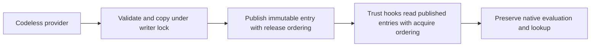

# Trust model and implementation

AMFIAnchor adds explicitly configured SPKI/SKID root anchors through two CoreTrust
hooks. It can run independently for custom-signed components or coexist with
stock AMFIPass for Dortania-signed OCLP payloads. It does not modify OCLP detection,
impersonate AMFIPass, or inject boot arguments.

The engine accepts Darwin 20 through 25 (Big Sur through Tahoe). The CoreTrust
certificate layout and root policy are shared across these families; no
per-OS anchor table or hook implementation is selected. Other kernel families
require a reviewed ABI and live qualification before the guard is widened.
There is no beta override.

## Source map

| Source | Responsibility |
| --- | --- |
| `kern_start.cpp` | Early Lilu registration, IOKit service, codeless providers |
| `kern_anchor.hpp/cpp` | Bounded input validation, boot-lifetime ownership, lookup |
| `kern_coretrust.hpp/cpp` | Private ABI, original-call preservation, Long routing |

## Trust boundary

Adding an anchor is a trust decision. Appropriate code signed under that CA can
receive platform trust; this is not restricted to GPU bundles. Keep its private
keys secret, including keys used by an accepted test injector. Public certificates
and SPKI/SKID values are not private keys.

The policy hook preserves native evaluation and applies additional policy only
for a registered public key. The lookup hook always calls the original and supplies an
additional root only when native lookup misses. Unregistered libraries and modified
signed code remain subject to normal validation. Positive and negative controls
must be checked when changing these paths.

Before routing, the policy hook checks the native entry for `test rdi,rdi` followed
by `jz rel32` to a `ret` inside the loaded CoreTrust image. Lilu copies that relative
branch into its trampoline without adjusting the displacement. When this exact
native NULL no-op is recognised, the wrapper reproduces it by omitting only the
native call for NULL policy. Registered-anchor processing still follows. Other
calls retain the original function call. The policy function has a void ABI;
anchor trust is written to the certificate's policy flags.

This decision is made from the loaded function's bytes, not an OS-version table.
It does not widen the supported kernel range. The recognition flag is published
with release ordering before routing exposes the wrapper, which reads it with
acquire ordering. IORegistry exposes `NativeNullPolicyNoOp`, `NullPolicyCalls`,
and `NullPolicyNativeSkipped` without publishing kernel addresses.

The caller that controls installed kexts and boot configuration chooses the trust
sources. There is no runtime user client or API to accept anchors from ordinary
applications. Providers read their own IORegistry properties during start.

## Lifetime and concurrency

Providers may allocate and take the sole writer lock. Valid key bytes, IDs and
certificate objects are copied into a fixed array of 16 entries. Writers fill an
entire entry before publishing its count with release ordering. Hooks acquire the
count, allocate nothing, take no locks, and access only published entries.

Key bytes and storage addresses do not change after publication. CoreTrust can
write certificate policy flags. Counters use atomic operations; a diagnostic dump
is not an atomic snapshot of all counters together.

Accepted data lasts until reboot. Removing a provider does not revoke its already
copied anchor. The implementation cannot unload safely after routing, and there
is no hot-reload or revocation mechanism. Changing installed trust data requires
a reboot.

## Compatibility observations and provenance

CoreTrust certificate offsets and the additional-root policy were recovered while
analyzing AMFIPass 1.4.1 for interoperability. Public CoreTrust research also helped
identify the relevant path. This is not a clean-room provenance claim. See
[NOTICES.md](../NOTICES.md); no AMFIPass binary or decompiled source is included.

The pointer/size pairs at `0x58` and `0xB8`, policy at `0xF0`, and certificate size
`0x130` are private ABI assumptions, checked structurally at build time and verified
by live signing controls on the supported kernel. Compile-time assertions alone
cannot prove that an unknown OS retains the same ABI.

AMFIAnchor must register before another plugin's CoreTrust hook when coexisting.
It requests Long routing so Lilu can preserve the chain. A preexisting short jump
is rejected. Later entry targets are exposed only as boolean diagnostics, without
publishing kernel pointer values; functionality must be established with signing
controls and per-anchor counters.
